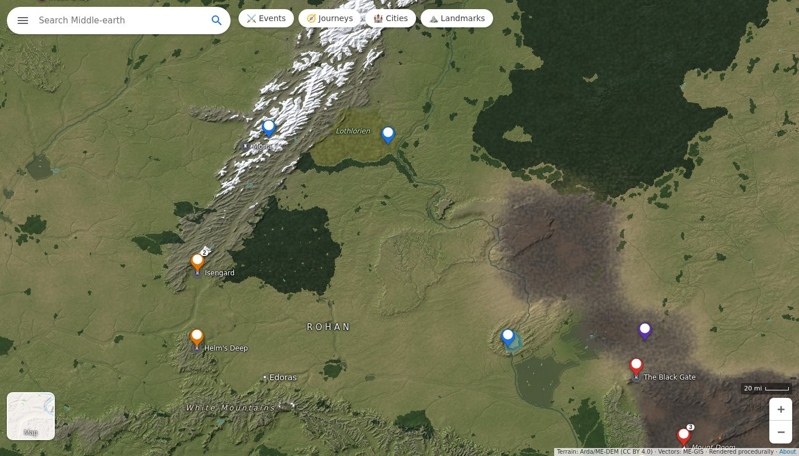
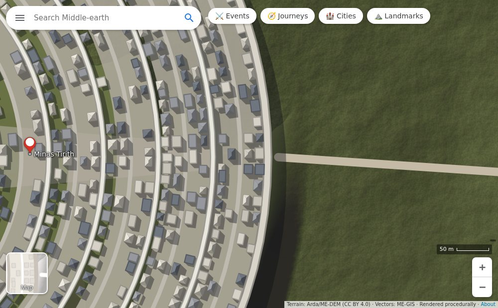
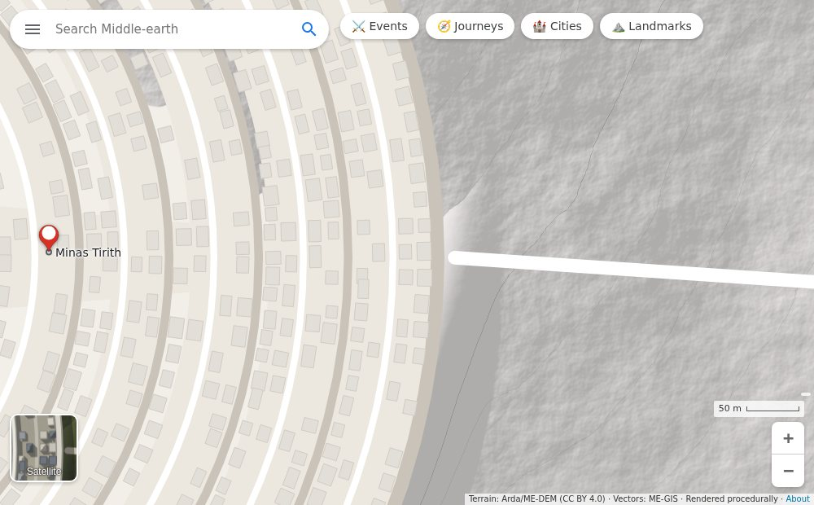
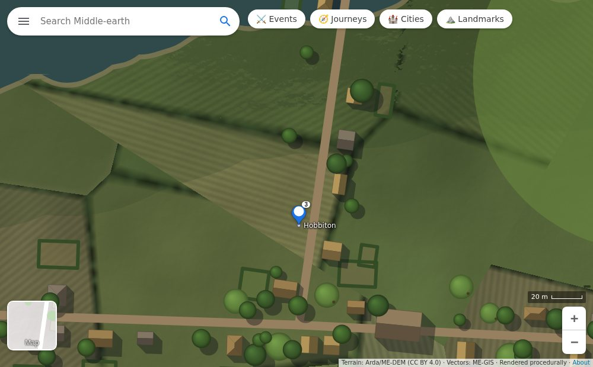
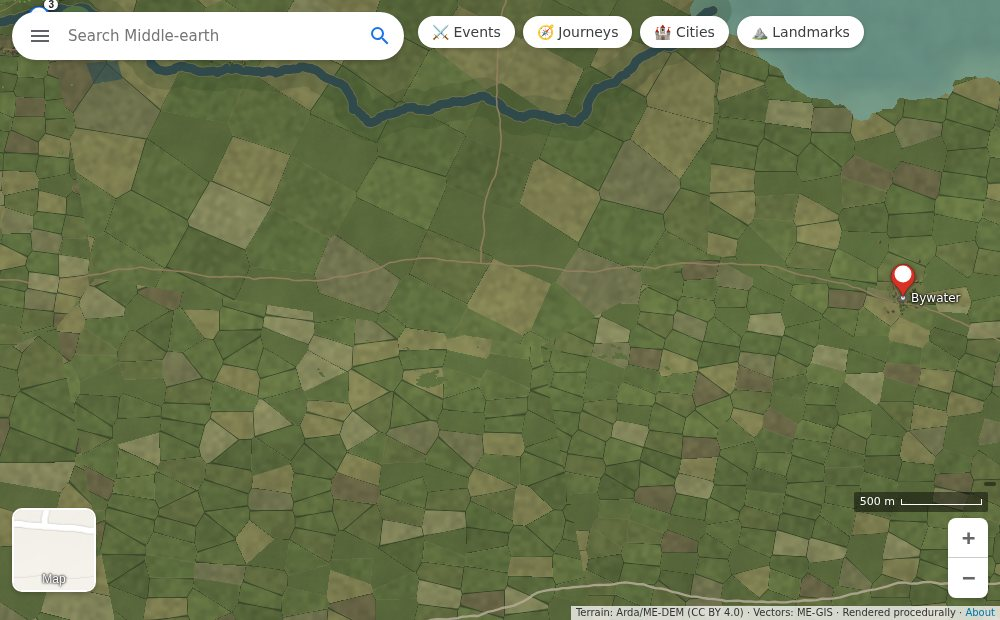
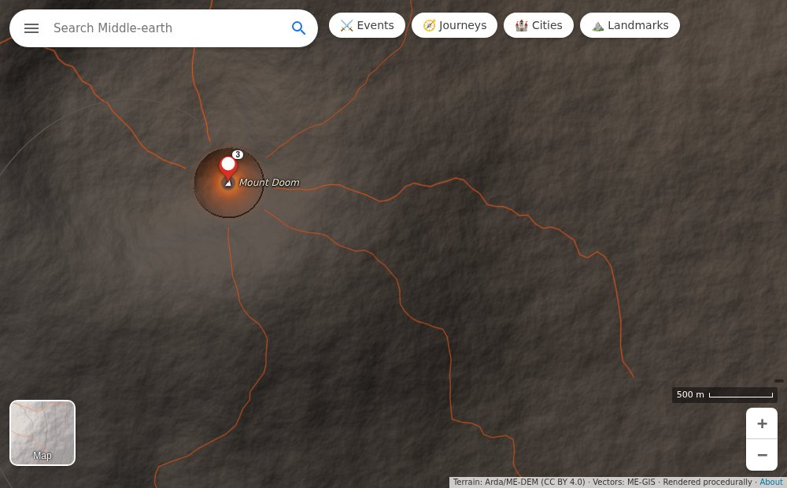
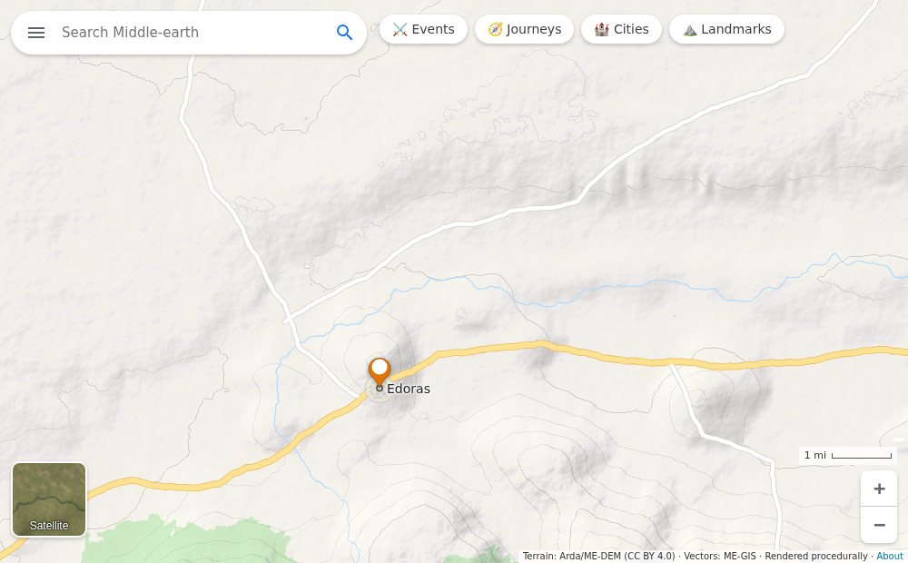

# Middle-earth Maps

A Google-Maps-style map of Middle-earth (and the islands off its coast, plus **Númenor** far out in
the western sea) that runs entirely in the browser, with two modes:

* **Satellite**: photo-like imagery rendered on the fly from a real elevation model. It shows
  hill-shaded terrain, snow and rock, sea depth and pack ice, rivers with green riverside
  corridors, forests that resolve into individual tree crowns, farmland patchwork with hedgerows,
  and procedurally generated towns. At high zoom you see individual buildings with lit roofs and
  cast shadows. Hand-built landmarks include Minas Tirith's seven walls, Orthanc in the Ring of
  Isengard, Barad-dûr, Mount Doom's crater and lava, Edoras with Meduseld, the Black Gate, the
  Argonath, Lake-town and Caras Galadhon.
* **Map**: the familiar Google look. Pale land, blue water, green woods, white and yellow roads,
  grey building footprints, and optional relief shading with contour lines ("Terrain").

On top of both: Google-style labels with collision handling, search with autocomplete, place cards
(each with a **film still from Peter Jackson's trilogies** where one exists, or a rendered aerial
"photo", plus a description, events, nearby places and a share link), about 70
**events** from the Elder Days to the Grey Havens (pins plus a filterable timeline), the main
**journeys** drawn like Google directions, a distance measurer, "What's here?", a scale bar in
miles, and shareable URLs (`#zoom/x-km/y-km/mode`).



| | |
|---|---|
|  Minas Tirith, satellite (z14) |  Minas Tirith, map (z14) |
|  Hobbiton (z15) |  Shire farmland near Bywater (z11) |
|  Mount Doom's crater and lava (z11) |  Edoras, map mode with terrain (z9) |

## Opening it

Open `web/index.html` in a modern browser (Chrome, Edge, Firefox or Safari 16.4+). That's it: no
server and no build step are needed to *view* the map. Everything, including terrain data, is loaded
with plain `<script>` tags so it also works from `file://`.

If your browser is strict about local files, serve the folder instead:

```bash
cd web && python3 -m http.server 8000   # then open http://localhost:8000
```

Tips: right-click the map for coordinates, "What's here?" and measuring. Use the chips at the top
for the event timeline, journeys, cities and landmarks. Use the square at the bottom left to switch
between Map and Satellite (hover it for the layer options).

## How it works

```
sources/ (downloaded, not committed)        tools/ (Python, run once)            web/ (static site)
  dem_{nw,ne,sw,se}.tif  32k x 32k DEM  ──►  build_terrain.py ──► tiles/terrain/{z}/{x}/{y}.js
  vectors.gpkg           ME-GIS layers  ──►  build_vectors.py ──► data/vectors.js
                                                                    data/*.js (hand-written)
                                                                    js/engine/*  (renderer)
                                                                    js/app.js    (UI)
```

1. **Terrain data tiles** (`tools/build_terrain.py`). The 32k DEM is resampled into a tile pyramid,
   z0 to z6, with 256 px tiles plus 2 px of padding. z6 is 16384 px across the world, about 122 map
   units (about 200 m) per pixel. Each tile stores three planes:
   * `E`: elevation in half metres. Sea pixels hold negative depth (bathymetry, see below).
   * `C`: a landcover class rasterised from ME-GIS polygons: forest, dark forest (Mirkwood,
     Fangorn, Old Forest), golden forest (Lórien), wetland, lake, sea, volcanic, stonefield.
   * `D`: water depth for lakes.

   E uses the LOCO-I/MED predictor. The planes are deflated and wrapped as
   `MEterrain("z/x/y","<base64>")` JavaScript calls so they load from `file://`. The browser
   inflates them with `DecompressionStream`.
2. **Vectors** (`tools/build_vectors.py`) exports rivers (with widths from drainage accumulation),
   roads, settlement points and natural-feature labels to `web/data/vectors.js`.
3. **Rendering** happens in Web Workers (`web/js/engine/worker.js` and `settlements.js`). They are
   started from a Blob URL, which also works from `file://`. For each 256 px tile (or 512 px on
   retina screens) the worker:
   1. Samples elevation bicubically and adds **band-limited procedural detail** (fBm octaves whose
      wavelength is below the data resolution and above two pixels). Every zoom level is therefore
      a consistent, alias-free view of the same infinitely detailed world. Analytic **terrain
      stamps** add landmark terrain: Minas Tirith's terraces, Mount Doom's crater, Edoras's hill.
   2. Colours each pixel. A small Whittaker-style climate model (temperature from latitude and
      altitude; moisture falling from west to east, edited by hand-drawn zones in
      `data/climate.js`) gives the ground colour. That is then modified by drainage curvature
      (green valleys, pale ridges), blight, beaches, Voronoi farm parcels, rock on steep or high
      ground, a latitude-dependent snowline, and forests, with tree crowns from a jittered grid
      once a tree is larger than about 3 px. Water colour comes from depth, plus sea ice in the
      far north. Hill shading uses a north-west sun.
   3. Draws vectors on a 2D canvas: rivers (meandered deterministically by midpoint displacement,
      so all tiles agree), roads, and settlements. Settlements are generated deterministically
      from their name into streets, walls, buildings, trees, ships and glows, then drawn with
      shadows (one union path), gable and hip roofs shaded per face, and round towers.
4. **UI** (`web/js/app.js`, `labels.js`, `css/app.css`): Leaflet 1.9.4 (vendored) with a custom
   CRS, a DOM label layer with greedy collision handling, and the Google-like chrome.

### Coordinates and scale

* **Map units (mu)** are metres of the ME-DEM projection (UTM 31N, as used by the source data):
  `x` = east from the west edge, `y` = **south** from the north edge, both 0 to 2,001,000. In
  Leaflet, `latlng = [y, x]`. Data files use **map kilometres** `[east, south]`, so Hobbiton is
  `[519, 956]` and Minas Tirith is `[1115.5, 1380.6]`.
* ME-DEM's "kilometres" match **Tolkien's miles** well. Edoras to Minas Tirith is 102 leagues
  (306 mi) by road in *The Return of the King*; it is 277 mu-km in a straight line here. The Shire
  is about 120 miles wide in both. So **1 map km = 1 mile**, 1 mu ≈ 1.609 real metres, and building
  sizes and the scale bar use that.
* The **fictional latitude/longitude** shown in the UI puts Hobbiton at Oxford's latitude
  (51.75°N), as Tolkien suggested. It is decorative.
* Elevation: raw DEM value 5590 is sea level, and metres = (raw − 5590) × 0.06 (`K_M` in
  `tools/common.py`). That gives about 3.5 km for the highest Misty Mountains peaks. Below sea
  level the DEM has contour-derived "terraces"; those are smoothed and remapped to a plausible
  shelf-and-abyss bathymetry.

### Film stills in place cards

`tools/build_photos.py` (stdlib only, about a minute) asks the
[LOTR Fandom wiki](https://lotr.fandom.com) API, for every place and event, which images on its page
or in its "Images of …" category are tagged as coming from *The Fellowship of the Ring*, *The Two
Towers*, *The Return of the King* or the *Hobbit* films. For places it prefers wide scenery shots,
and it penalises shots tagged with characters and template images that appear on many pages. The
results go to `web/data/photos.js`, currently 44 places and 37 events. When nothing convincing
exists (Tharbad, Lindon, Númenor…), the card shows the rendered aerial view instead.
`OVERRIDES` in the script holds hand-picked files, or `None` to suppress a wrong match.

The stills are **copyrighted by New Line Cinema / Warner Bros.** They are *not* stored in this
repository. The browser loads them straight from the wiki's CDN, which hosts them under fair use,
with a credit link on each card. So they need an internet connection, and if you publish this map,
whether to keep them is your call.

### Checking against the Encyclopedia of Arda

The [Encyclopedia of Arda](https://www.encyclopedia-of-arda.com) has about 1,300 entries with
regional maps (around 370 distinct maps that we could align). Every label on those maps is an HTML
image-map area with pixel coordinates, which makes a systematic check possible:

1. `sources/arda-ref/crawl.sh` downloads the entry pages slowly (the site rate-limits; please keep
   the delay). They stay in `sources/` (gitignored).
2. `tools/arda_compare.py` fits each Arda map onto our coordinates: a north-up similarity
   transform with RANSAC, anchored on places we both have, plus local residual correction. It then
   estimates every Arda label's position in our frame, preferring the estimate most maps agree on.
   It writes `sources/arda-ref/report.md`, which lists disagreements and places we lack.
3. `tools/arda_apply.py` writes `web/data/arda.js`:
   * **~60 extra places** (Bindbole Wood, Three-Farthing Stone, Harrowdale, Dol Baran,
     Narrows of the Forest…), filtered for trustworthy fits, variant spellings, rivers (already
     labelled along the water) and First-Age places that would land in the sea;
   * **position fixes** for places we had placed by hand (e.g. Crickhollow);
   * **zoom hints**: a label appears at the zoom whose scale matches the coarsest Arda map that
     names it, so our label density follows theirs;
   * a "Read about … in the Encyclopedia of Arda" link on place cards.
   No text or images from Arda are copied into the map; only positions and links.
4. `tools/test/arda_side.py shire gondor …` renders an Arda map next to ours at the same frame,
   for visual review (into `/tmp/me/arda/`).

Places with `keep: true` in `places.js` ignore Arda's position. Minas Tirith stays on the
mountain's spur in our terrain. The Ford of Bruinen sits where our road crosses our river.

### Journeys

`js/routes.js` routes each journey leg along the ME-GIS road network (A* search; legs that would
be big detours fall back to overland). Legs marked `by: 'river'` follow the rivers, for example the
Fellowship's boats and Aragorn's ships. Legs marked `by: 'foot'` go overland as a smooth
centripetal Catmull-Rom curve with a gentle wander. The whole route is then corner-smoothed.
Roads on the tiles are also corner-smoothed (Chaikin) before drawing.

## Decisions log

| Date | Decision | Why |
|---|---|---|
| 2026-11-20 | Use the **Arda 32k eroded DEM** (therealJiko / ME-DEM team, CC BY 4.0) plus **ME-GIS** vectors as the geographic base. | They are the best openly available Middle-earth geodata. The DEM was built from real-world elevation and simulated erosion, so drainage and valleys look real. Scanned paper maps are too low-res. |
| 2026-11-20 | **Render imagery procedurally in the browser** instead of pre-rendering image tiles. | Pre-rendered tiles to building-level zoom (z15+) would take terabytes. Procedural rendering gives unlimited zoom, keeps the repo about 250 MB, and lets contributors change the look by editing JS, without re-running a heavy build. The build machine is shared, so the heavy work had to be light anyway. |
| 2026-11-20 | Data pyramid stops at **z6** (~200 m/px). | z7 lossless would be ~360 MB more. Detail below z6 comes from band-limited noise, and the difference is small at the zooms where it matters. `MAXZ` in `tools/common.py` can be raised. |
| 2026-11-20 | Sea level at raw value **5590**, not 0. | The DEM stores sea floor as stepped contour terraces up to 5584. The ME-GIS coastline follows the 5584/5600 boundary, and the Bay of Belfalas and Gulf of Lune only become sea with this threshold. |
| 2026-11-20 | Landcover boundaries use **domain-warped nearest-neighbour** lookup. | ME-GIS forest polygons are coarse, sometimes literal triangles. Multi-octave warping makes them organic at every zoom without changing the data. |
| 2026-11-20 | **Moved Minas Tirith 6.2 km west** of its ME-GIS point, onto the real eastern tip of the White Mountains in the DEM. | Tolkien's city is built on a spur of Mindolluin. The GIS point sits on the plain. A procedural "massif" stamp was tried and looked fake, so it is disabled (`massif: true` re-enables it). |
| 2026-11-20 | **Mount Doom** placed at the DEM's own volcanic cone, [1223.2, 1338.2], not the GIS label (6 km east). | The DEM already has a 1,600 m cone with a crater; we only add a crater, lava and the Sammath Naur road. |
| 2026-11-20 | Map units are treated as Tolkien miles / 1000 (1 mu ≈ 1.6 m). | Distances match the books (see above); building sizes follow from it. |
| 2026-11-20 | Places from **MERP** (Middle-earth Role Playing) in ME-GIS are kept but marked non-canonical, with lower label priority. | They fill the empty south and east with towns, but they are not Tolkien's. |
| 2026-11-20 | Everything loads via `<script>` (JSONP-style) and workers come from Blob URLs. | So the map opens by double-clicking `index.html`. `fetch()` and `new Worker(path)` are blocked on `file://`. |
| 2026-11-20 | **Númenor** added as an analytic island west of the DEM (x < 0): coastline radius r(θ) from five Gaussian promontories, multi-scale noise for a fractal coast, a central peak, and shelf bathymetry. | The brief asked for "islands around", and Númenor is the most important island in the legendarium. It costs a few lines of math and no data. The placement is artistic, as Tolkien gives no distance. |
| 2026-11-20 | Film stills are **hotlinked from the LOTR Fandom wiki** with credits, never copied into the repo. Matching is automatic (film categories plus scoring), with a small override list. | The stills give visual recall of each place from the films, but they are copyrighted. Linking keeps the repo free of them, and a missing link falls back to the aerial render. |
| 2026-11-20 | Mountains, rock, snow and the map-mode grey tint are driven by **relief** (height above the surrounding low ground, `data/relief.js` from `tools/build_relief.py`) instead of absolute height. | Compared with atlas-style maps (Encyclopedia of Arda), ours hid the ranges that define Middle-earth. Mordor's plain is ~1,200 m and the Ephel Dúath only ~700 m above it, so a height threshold either buried them in blight or painted all of Mordor as mountain. Snow also blanketed the whole Misty and Grey Mountains, because altitude cooling fed the polar-snow rule. Now only summits are white. |
| 2026-11-20 | Denser labels: river names along the rivers, lower zoom thresholds, and atlas regions (North/South Ithilien, Cross-roads, Morgai, Harlond, Cair Andros, Isenmouthe…). | Reference maps at the same scale name far more features. |
| 2026-11-20 | **Systematic Encyclopedia of Arda check** with image-map labels and RANSAC-fitted transforms, instead of eyeballing a few maps. | It covers every regional map, catches label-offset and edge-pointer errors through cross-map agreement, and is repeatable. It only adds places and changes positions we placed by hand: GIS-anchored places agree with our terrain and rivers, so their disagreements are only reported. |
| 2026-11-20 | Label zoom thresholds lowered across the board, and rivers and named roads drawn from z2–z5. | Side-by-sides showed Arda's maps naming three to five times as many features at the same scale. Collision handling keeps it readable. |
| 2026-11-20 | Journeys routed on roads and rivers and smoothed. | Straight waypoint-to-waypoint lines looked artificial and ignored the roads the travellers actually used. |
| 2026-11-20 | fBm uses **gradient noise** and drops octaves under 3 px per cell. | Value noise near the pixel limit showed up as blocky squares at low zoom. |
| 2026-11-20 | Farmland at low zoom uses the **expected** field coverage, not per-farm coin flips. | Per-farm on/off decisions aliased into a checkerboard when farms were only a few pixels wide. |

## Contributing

Most improvements need **no build step**: edit a file in `web/` and reload.

| You want to… | Edit |
|---|---|
| Add or fix a place description | `web/data/places.js` (position by `site`, `label` or `km`) |
| Add a historical event | `web/data/events.js` |
| Improve a journey route | `web/data/journeys.js` |
| Change where it's desert, farmland, blighted, Rohan grass… | `web/data/climate.js` (polygons in map km) |
| Change a town's style or size, or attach a landmark generator | `web/data/settlements.js` |
| Reshape Númenor or add another island beyond the DEM | `web/data/islands.js` |
| Change which film still a place shows | `OVERRIDES` in `tools/build_photos.py`, then re-run it |
| Build a new landmark (e.g. Dol Amroth's castle, Moria's West-gate) | add a function to `SPECIALS` in `web/js/engine/settlements.js` |
| Tweak satellite colours, forests, fields, snow | `satPixel`, `fields`, `trees` in `web/js/engine/worker.js` |
| Tweak the map-mode style | `MAPC` and `mapPixel` in `worker.js`, label styles in `web/css/app.css` |

Use right-click → *Copy map coordinates* to get `[east, south]` km values for the data files.

### Rebuilding the data (only if you change the build tools)

Everything in `web/` is committed, so the map runs straight from a clone. The raw inputs are *not*
in git; scripts re-create them:

```bash
tools/download_sources.sh      # Arda DEM + ME-GIS vectors -> sources/ (~1 GB)
tools/arda_crawl.sh            # optional: Encyclopedia of Arda pages -> sources/arda-ref/ (slow, rate-limited)
tools/rebuild_all.sh           # terrain tiles, vectors, relief, Arda cross-check -> web/
WITH_NETWORK=1 tools/rebuild_all.sh   # also refresh film-still links (web/data/photos.js)
```

`rebuild_all.sh` creates a Python venv (numpy, pillow, tifffile, imagecodecs, scipy, shapely) and
caps memory, because the build machine is shared.

### Visual testing

`tools/test/` holds Playwright scripts that render views headlessly (with a memory cap):

```bash
cd tools/test && PLAYWRIGHT_SKIP_BROWSER_DOWNLOAD=1 npm i && cd ../..
tools/test/multi.sh mt "#13/1115.5/1380.6/satellite" hob "#15/519.24/955.99/map"   # -> /tmp/me/*.png
node tools/test/ui.js                                                                 # search, cards, events, journeys
```

Set `CHROME=/path/to/chrome` if Playwright's own browser is not installed.

### Repository notes

* `sources/`, `build_tmp/`, `.venv/` and `tools/test/node_modules/` are ignored (see `.gitignore`).
* `web/tiles/terrain/` is about 235 MB of generated data. Either commit it with Git LFS, or publish
  it as a release asset and have contributors run the build.

## Known gaps / roadmap

* **Local distances follow ME-GIS (Tolkien's general map), not his large-scale Gondor map.** For
  example, Osgiliath is ~25 miles from Minas Tirith here, but ~15 miles on the large map that the
  Encyclopedia of Arda redraws. Fixing this means locally warping the DEM and vectors.

* **Islands**: Tol Fuin, Himling and Tol Morwen (north-west), Tolfalas, Cair Andros, Tol Brandir
  and the Carrock come from the DEM. **Númenor** is procedural (`data/islands.js`): a five-pronged
  star with the Meneltarma, Nísimaldar's woods, Armenelos, Rómenna, Andúnië and Eldalondë, about
  1,000 miles west of Lindon. It is shown at its Second-Age height, although it sank in S.A. 3319.
  Possible next steps: an era toggle that hides it, and **Tol Eressëa / Aman** further west.
* A z7 terrain level, or a lossy detail layer, for sharper valleys at zoom 8–11.
* Rivers are lines. The Anduin's lower course and the Ethir delta deserve polygons with sandbars.
* Desert dunes, wadis and oases in Harad; vineyards in Dorwinion; Nurn's slave-fields as a grid.
* More landmarks: Dol Amroth castle, Moria's West-gate with the holly trees, Rivendell's
  waterfalls, Erebor's Front Gate and Dale, Dunharrow's switchbacks, the Hornburg in a proper
  gorge, Cirith Ungol's stair, the Grey Havens quays.
* Kingdom borders (dashed lines in map mode) and a time slider (e.g. Isengard flooded after
  3 March 3019, Osgiliath before the ruin).
* "Directions" between places along roads, with travel time on foot, pony or horse.

## Credits & licences

* **Elevation**: Arda 32k DEM by Pete Lewis (therealJiko), derived from the ME-DEM by monks and
  Redrobes (Outerra forum), distributed by [bburns/Arda](https://github.com/bburns/Arda) under
  **CC BY 4.0**.
* **Vectors**: [ME-GIS](https://github.com/andrewheiss/ME-GIS) by monks, SeerBlue, Redrobes,
  jvangeld and others, via Arda's `vectors.gpkg`. The authors say they "typically approve most
  personal and educational uses". Ask them before any other use.
* **Leaflet** 1.9.4, BSD-2-Clause (vendored in `web/vendor/leaflet`).
* Middle-earth, its places, characters and events are the creation of **J.R.R. Tolkien**. This is
  a non-commercial fan project. Descriptions are written fresh, with short quotations from the
  books. Imagery is an artistic reconstruction, not a canonical depiction.
